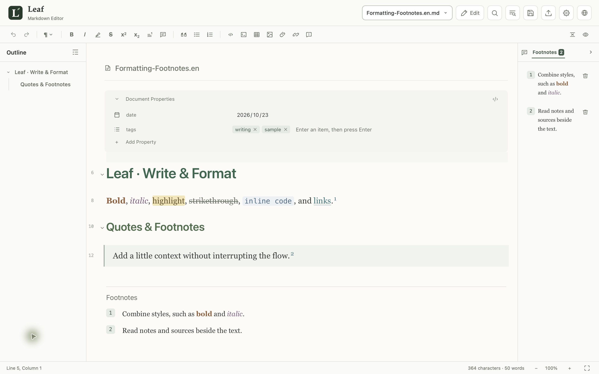
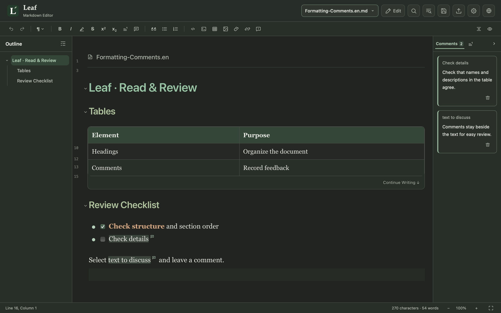

[简体中文](README.zh-CN.md) · [繁體中文](README.zh-TW.md) · **English**

  

A Markdown editor with live preview, designed for focused writing and thoughtful review. Connect your AI apps through MCP for help with editing and reviewing.

  
  
  
  
   
  
  
  

  

If your system blocks the first launch, see <a href="docs/INSTALL.md#first-launch-security-prompts">first-launch security prompts</a>.

  <a href="#features">Features</a> ·
  <a href="#help">Help</a> ·
  <a href="https://github.com/CoozeeWang/leaf-markdown/issues">Feedback</a>

If Leaf helps you, consider supporting its continued development.

  

What would you like to see in Leaf next? More interface languages, more Markdown extensions, or features that make writing and reviewing easier? Share your wishlist in <a href="https://github.com/CoozeeWang/leaf-markdown/issues">Issues</a>.

## Features

| Feature | What it does |
| :--- | :--- |
| **Live preview** | See formatting as you write with WYSIWYG (what you see is what you get) editing. Switch between Edit, Source, and Reading views. |
| **MCP connection** | Connect ChatGPT, Claude Desktop, and WorkBuddy through MCP to read, edit, and review your documents. |
| **Outline navigation** | See your document's structure by heading and jump straight to any section. |
| **Document properties** | View and edit details such as author, date, and tags in one place, keeping document details organized. |
| **Footnote sidebar** | Read and edit footnotes beside the text, checking explanations and sources without repeatedly jumping to the end. |
| **Document comments** | Add comments to selected text or a position in the document, then review and edit them in the sidebar. Obsidian hidden comments are also supported. |
| **Table editing** | Edit cells directly and easily add rows and columns to organize information. |
| **Image management** | Images are saved in a companion folder beside the document, so you can organize and move them together. |
| **PDF export** | Export a formatted PDF for sharing and printing. |
| **Draft recovery** | Keep a recovery copy of unsaved changes, so you can pick up where you left off after an interruption. |

## Download and get started

Visit the [download page](https://github.com/CoozeeWang/leaf-markdown/releases) and choose the package for your computer:

- **Windows**: Download the `.exe` installer, double-click it, and follow the instructions.
- **Mac (Apple silicon)**: Download and open the `.dmg` file, then drag Leaf into Applications.

Open Leaf and create a document to start writing, or open or drag in an existing Markdown file.

To connect AI, enable MCP under **Settings → AI-Assisted Editing** and follow [AI-assisted editing and MCP connections](docs/AI_CONNECTIONS.md).

### App updates

Leaf 1.0.3 checks for updates and shows release notes within the app, then opens the official download page in your browser. Save your documents and quit Leaf normally before installing the update manually: replace Leaf in Applications on Mac, or run the Windows installer over the existing installation. This version does not download or install updates within the app, or quit and restart automatically.

For installation help, see [Installation and usage guide](docs/INSTALL.md).

## Help

For help installing or using Leaf, see:

- [Installation and usage guide](docs/INSTALL.md)
- [AI-assisted editing and MCP connections](docs/AI_CONNECTIONS.md)

## Feedback

If you encounter an issue or have a feature suggestion, let us know through [GitHub Issues](https://github.com/CoozeeWang/leaf-markdown/issues). Include your operating system, Leaf version, and steps to reproduce the problem. Remove private content and keys from screenshots and sample documents.

## License

Leaf's original code is licensed under the [MIT License](LICENSE). The third-party callout icons included in the project retain their [original license](src/assets/callouts/LICENSE).
