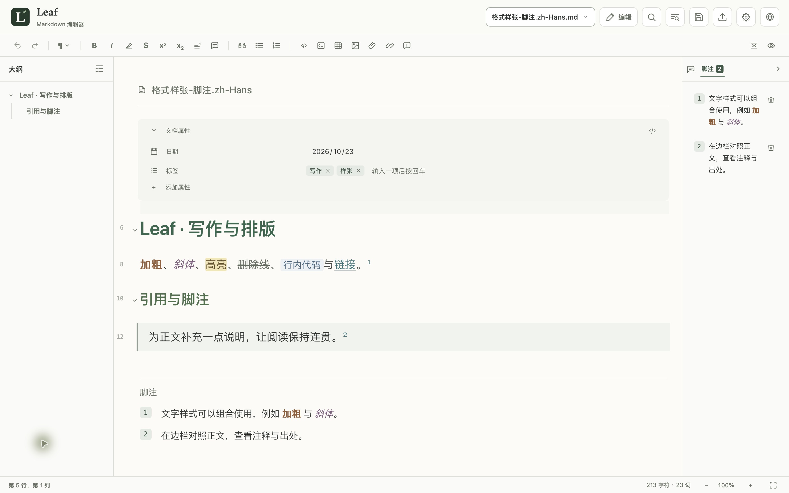
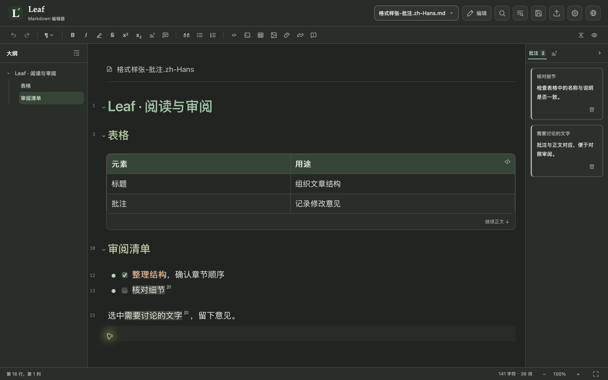

**简体中文** · [繁體中文](README.zh-TW.md) · [English](README.md)

  

一款可实时预览的 Markdown 编辑器，兼顾专注写作与文稿审阅。 支持 MCP 插件，连接 AI 软件辅助编辑与审阅。

  
  
  
  
   
  
  
  

  

首次打开遇到系统拦截，请参阅<a href="docs/INSTALL.zh-CN.md#首次打开安全提示">首次打开安全提示</a>。

  <a href="#功能特色">功能特色</a> ·
  <a href="#使用帮助">使用帮助</a> ·
  <a href="https://github.com/CoozeeWang/leaf-markdown/issues">问题反馈</a>

如果 Leaf 对你有所帮助，欢迎赞助，支持它的持续开发。也欢迎告诉我们，你希望 Leaf 接下来支持什么：更多界面语言、更多 Markdown 扩展语法，或其他让写作与审阅更顺手的功能。欢迎在 <a href="https://github.com/CoozeeWang/leaf-markdown/issues">Issues</a> 中留下你的愿望清单。

  

## 功能特色

| 功能 | 介绍 |
| :--- | :--- |
| **实时预览** | 编辑时即时呈现排版效果，支持编辑、源码和阅读三种视图，按需切换。 |
| **MCP 接入** | 通过 MCP 连接 ChatGPT、Claude（桌面版）和 WorkBuddy，读取和修改文稿，让 AI 参与写作与审阅。 |
| **大纲导航** | 按标题呈现文章结构，点击即可跳转，在不同章节之间快速定位。 |
| **文档属性** | 集中查看和编辑文稿的作者、日期、标签等信息，让正文之外的资料也井然有序。 |
| **脚注边栏** | 在边栏查看和编辑脚注，对照正文核对说明与出处，无需频繁跳转文末。 |
| **文稿批注** | 为选中文字或正文位置添加批注，在边栏集中查看和编辑；兼容 Obsidian 隐藏式批注。 |
| **表格编辑** | 直接在表格中编辑内容，便捷地添加行和列，整理信息更直观。 |
| **图片管理** | 文档中的图片自动保存到文档旁的配套文件夹，便于一起整理和移动。 |
| **PDF 导出** | 保留文稿的排版样式，导出为 PDF，方便分享与打印。 |
| **草稿恢复** | 自动留存尚未保存的修改，意外中断后可找回草稿，继续写作。 |

## 下载与开始使用

前往 [下载页面](https://github.com/CoozeeWang/leaf-markdown/releases)，选择适合你电脑的安装包：

- **Windows**：下载 `.exe` 安装包，双击后按提示安装。
- **Mac（M 系列芯片）**：下载并打开 `.dmg` 文件，将 Leaf 拖入“应用程序”文件夹。

打开 Leaf，新建文档即可开始写作，也可以打开或拖入已有的 Markdown 文件。

如需连接 AI，在“设置 → AI 辅助编辑”中开启 MCP，并按照[AI 辅助编辑与 MCP 连接](docs/AI_CONNECTIONS.zh-CN.md)完成配置。

### 应用更新

Leaf 1.0.3 可在应用内检查更新并查看发布说明，然后通过浏览器前往官方下载页面。请保存文稿并正常退出 Leaf，再手动安装新版：Mac 在“应用程序”原位置替换 Leaf，Windows 按安装器提示覆盖原安装。本版不会在应用内下载安装或自动退出重启。

安装时遇到问题，请查看[安装与使用说明](docs/INSTALL.zh-CN.md)。

## 使用帮助

安装或使用过程中需要帮助，可查阅以下说明：

- [安装与使用说明](docs/INSTALL.zh-CN.md)
- [AI 辅助编辑与 MCP 连接](docs/AI_CONNECTIONS.zh-CN.md)

## 问题反馈

遇到问题或有功能建议，欢迎通过 [GitHub Issues](https://github.com/CoozeeWang/leaf-markdown/issues) 告诉我们。反馈问题时，请附上系统、Leaf 版本和复现步骤；截图与示例文档中请勿包含私人内容或密钥。

## 开源许可

Leaf 的原创代码采用 [MIT 许可证](LICENSE)。随项目提供的第三方提示块图标保留其[原有许可证](src/assets/callouts/LICENSE)。
