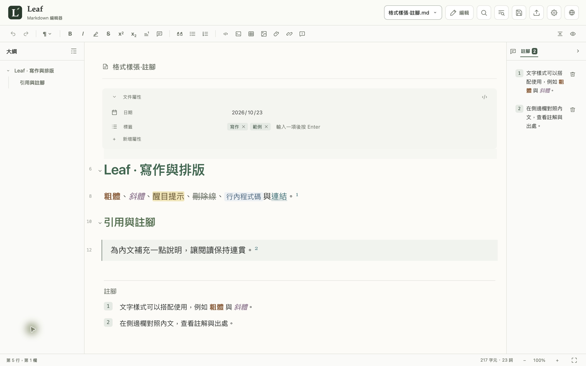
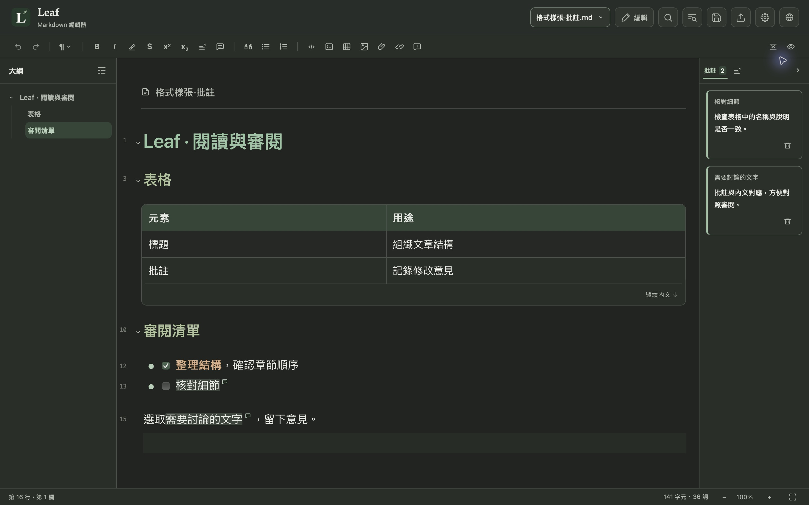

[简体中文](README.zh-CN.md) · **繁體中文** · [English](README.md)

  

一款可即時預覽的 Markdown 編輯器，兼顧專注寫作與文稿審閱。 支援 MCP 外掛，連接 AI 軟體輔助編輯與審閱。

  
  
  
  
   
  
  
  

  

首次開啟遇到系統攔截，請參閱<a href="docs/INSTALL.zh-TW.md#首次開啟安全提示">首次開啟安全提示</a>。

  <a href="#功能特色">功能特色</a> ·
  <a href="#使用說明">使用說明</a> ·
  <a href="https://github.com/CoozeeWang/leaf-markdown/issues">問題回報</a>

如果 Leaf 對你有所幫助，歡迎贊助，支持它的持續開發。

  

也歡迎告訴我們，你希望 Leaf 接下來支援什麼：更多介面語言、更多 Markdown 擴充語法，或其他讓寫作與審閱更順手的功能。歡迎在 <a href="https://github.com/CoozeeWang/leaf-markdown/issues">Issues</a> 中留下你的願望清單。

## 功能特色

| 功能 | 介紹 |
| :--- | :--- |
| **即時預覽** | 編輯時即時呈現排版效果，支援編輯、原始碼和閱讀三種檢視，依需要切換。 |
| **MCP 連線** | 透過 MCP 連接 ChatGPT、Claude（桌面版）和 WorkBuddy，讀取和修改文稿，讓 AI 參與寫作與審閱。 |
| **大綱導航** | 按標題呈現文章結構，點選即可跳至對應章節，快速找到所需內容。 |
| **文件屬性** | 集中檢視和編輯文稿的作者、日期、標籤等資訊，讓內文之外的資料也井然有序。 |
| **註腳側邊欄** | 在側邊欄檢視和編輯註腳，對照內文核對說明與出處，無需頻繁跳至文末。 |
| **文稿批註** | 為選取文字或內文位置新增批註，在側邊欄集中檢視和編輯；相容 Obsidian 隱藏式批註。 |
| **表格編輯** | 直接在表格中編輯內容，輕鬆新增列與欄，整理資訊更直觀。 |
| **圖片管理** | 文件中的圖片自動儲存到文件旁的對應資料夾，便於一起整理和移動。 |
| **PDF 匯出** | 保留文稿的排版樣式，匯出為 PDF，方便分享與列印。 |
| **草稿復原** | 自動留存尚未儲存的修改，意外中斷後可找回草稿，繼續寫作。 |

## 下載與開始使用

前往 [下載頁面](https://github.com/CoozeeWang/leaf-markdown/releases)，選擇適合你電腦的安裝檔：

- **Windows**：下載 `.exe` 安裝檔，按兩下後按提示安裝。
- **Mac（M 系列晶片）**：下載並開啟 `.dmg` 檔案，將 Leaf 拖入「應用程式」資料夾。

開啟 Leaf，新增文件即可開始寫作，也可以開啟或拖入已有的 Markdown 檔案。

如需連接 AI，在「設定 → AI 輔助編輯」中開啟 MCP，並按照[AI 輔助編輯與 MCP 連線](docs/AI_CONNECTIONS.zh-TW.md)完成設定。

### 應用程式更新

Leaf 1.0.3 可在應用程式內檢查更新並查看發布說明，再透過瀏覽器前往官方下載頁面。請先儲存文稿並正常結束 Leaf，再手動安裝新版：Mac 在「應用程式」原位置取代 Leaf，Windows 依安裝程式提示覆蓋原安裝。本版不會在應用程式內下載安裝或自動結束並重新啟動。

安裝時遇到問題，請參閱[安裝與使用說明](docs/INSTALL.zh-TW.md)。

## 使用說明

安裝或使用過程中需要幫助，可查閱以下說明：

- [安裝與使用說明](docs/INSTALL.zh-TW.md)
- [AI 輔助編輯與 MCP 連線](docs/AI_CONNECTIONS.zh-TW.md)

## 問題回報

遇到問題或有功能建議，歡迎透過 [GitHub Issues](https://github.com/CoozeeWang/leaf-markdown/issues) 告訴我們。回報問題時，請附上系統、Leaf 版本和重現步驟；截圖與範例文件中請勿包含私人內容或金鑰。

## 開源授權

Leaf 的原創程式碼採用 [MIT 授權條款](LICENSE)。隨專案提供的第三方提示區塊圖示保留其[原有授權條款](src/assets/callouts/LICENSE)。
